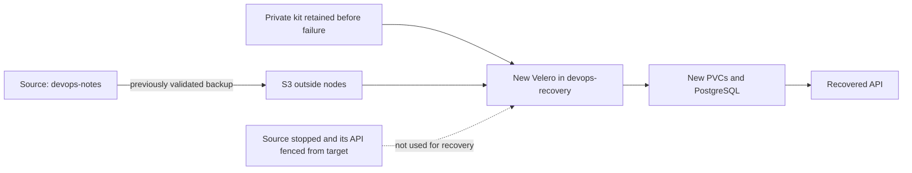

# What if the source cluster is unavailable?

English · [Português](README.md)

In [backup-restore-lab](https://github.com/tommmdl/backup-restore-lab), data returned in another namespace. Here the question changes: can that backup start the application in a different cluster without depending on the source API, PostgreSQL or Velero during recovery?

We create `kind-devops-recovery` with its own API server, certificates and node. A new Velero discovers the backup in S3, restores resources, puts the dump on a new PV and restores PostgreSQL. SQL and API checks cover data, schema, indexes, identity sequence and post-backup writes.



## What became unavailable during testing

The notes API, PostgreSQL StatefulSet and Velero Deployment for the isolated `backup-demo` environment were scaled to zero. Rules on the new cluster's node blocked source Kubernetes API traffic from both the node and Pods. A TCP probe verified connectivity before the fence, failure during recovery and connectivity afterward.

The original cluster was not destroyed. Its primary `notes-lab` application, GitOps, monitoring and other labs remained running. This tests recovery independence without stopping the entire study environment.

Target Velero is installed only after that interruption. We do not copy a Backup object between APIs with kubectl: the controller imports metadata from S3 and gets a different UID in the new cluster.

## Prepare the source and its backup

Use Linux x86_64 or WSL, Docker, Git, Bash and Python 3. Keep these repositories as siblings:

```bash
git clone https://github.com/tommmdl/kubernetes-lab.git
git clone https://github.com/tommmdl/backup-restore-lab.git
git clone https://github.com/tommmdl/disaster-recovery-lab.git
```

If there is no validated backup yet:

```bash
cd kubernetes-lab
bash scripts/prepare.sh
bash scripts/lab.sh up
cd ../backup-restore-lab
bash scripts/lab.sh up
python3 tests/verify.py
cd ../disaster-recovery-lab
```

If Argo CD already manages the primary cluster, reuse it instead of running basic up over it. If the earlier rehearsal completed, reuse its backup: this lab selects the successful backup recorded in backup-restore-lab's .local/last-run.json and checks phase, errors and expiry. The partial hook-failure backup is not selected.

## Retain recovery inputs before failure

```bash
bash scripts/lab.sh kit
```

The kit lives in .local/recovery-kit/: S3 credentials, original Kopia repository password, recovery plan and expected test values. The expected-values JSON is a verification reference; it is not applied to PostgreSQL. The restored dump comes from S3.

The kit does not contain the source cluster's kubeconfig. Do not publish these files: credentials unlock storage and the backup repository. This local folder is not an automatic offsite copy. A real recovery plan must retain kit and storage in separate failure domains.

## Create the destination and run the exercise

```bash
bash scripts/lab.sh create-target
python3 tests/verify.py
```

create-target uses the retained kit without contacting the source API. Target Velero installation also uses only the kit, new API and S3. The test queries the source before and after recovery to simulate the outage and validate restoration, not to populate target data.

Scripts use explicit kubeconfigs and contexts: kind-devops-notes for source and kind-devops-recovery for target. An existing cluster is not assumed to belong to this checkout. An existing dr-notes namespace is refused to avoid overwriting recovery data.

The test installs Velero in restore-only mode, validates a ReadOnly storage location, waits for backup discovery and restores into dr-notes. ReadOnly is a Velero setting, not an IAM credential restricted to reading; process logs and metadata may still be written to S3.

## What changes between clusters

The logical-backup PVC drops its old PV reference and maps to storage class dr-local-dump. The new PV has a path and affinity for devops-recovery-control-plane. The client Pod does not keep a source nodeName. PostgreSQL initializes a different data PVC before receiving the consistent logical dump.

The new cluster's generated kube-root-ca.crt ConfigMap is preserved. Checks prove source and target certificates differ and restore does not replace the target CA. Application configuration and Secret return from the backup.

The recovered file must match the pre-outage SHA-256, and the destination database must be empty. pg_restore --single-transaction --exit-on-error runs before enabling API replicas. The source stays stopped throughout SQL checks, API reads, a controlled write and replacement of the recovered database Pod.

## Inspect the result

```bash
bash scripts/lab.sh status
bash scripts/v.sh backup get
bash scripts/v.sh restore get
bash scripts/access.sh
```

Open [the second cluster's application](http://localhost:8022), bound to 127.0.0.1. The local rehearsal passed 32 checks: seven notes recovered while eight existed at the source at failure time. The eighth was written after backup and must be absent from the recovered point. [Results, timings and warnings](docs/validation.en.md) · [Recovery and return guide](docs/runbook.en.md).

Original replica counts and network rules return at the end. This reopens the study environment without merging databases or performing a production traffic failback. The controlled target write is deleted before source service returns.

## State and removal

S3 and its credentials belong to backup-restore-lab. This project keeps its private kit, target kubeconfig and snapshots in .local/. Public reports contain no passwords, dumps or reference note contents.

```bash
bash scripts/lab.sh down
```

down deletes only the devops-recovery cluster owned by this checkout and its recovered local volumes. Source cluster, S3 and private kit remain. To repeat the full test, deliberately remove the destination and create a fresh one; do not restore over dr-notes.

## Exercise limits

These are two real clusters on the same Docker/WSL host. Host loss, cloud, region failure, unavailable S3, DNS, load balancers and user traffic cutover were not tested. S3 sits outside nodes but shares their computer. Images depend on GHCR, and download tools must be available or retained.

The database is small and measured time is not an SLO. The dump provides neither WAL/PITR nor zero RPO. Recovery reflects the selected backup; later writes require another strategy. There is no automatic database merge or general protection against external writers during a real failover.

Creating another node on this WSL environment exhausted fs.inotify.max_user_instances=128. It was raised to 512 at runtime following kind guidance; no persistent sysctl file changed. The [record](evidence/host-inotify.json) and runbook explain the fix.

## References

[Velero disaster recovery](https://velero.io/docs/v1.18/disaster-case/) · [File System Backup and repository password](https://velero.io/docs/v1.18/file-system-backup/) · [Restore modifiers](https://velero.io/docs/v1.18/restore-resource-modifiers/) · [kind inotify limits](https://kind.sigs.k8s.io/docs/user/known-issues/#pod-errors-due-to-too-many-open-files).
