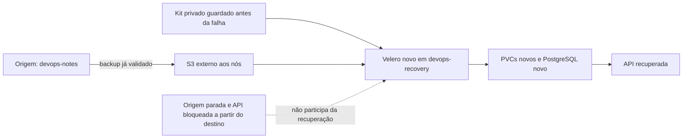

# E se o cluster de origem não estiver disponível?

[English](README.en.md) · Português

No [backup-restore-lab](https://github.com/tommmdl/backup-restore-lab), os dados voltaram em outro namespace. Aqui a pergunta muda: o mesmo backup consegue levantar a aplicação em outro cluster, sem depender da API, do PostgreSQL ou do Velero da origem durante a recuperação?

Criamos `kind-devops-recovery`, com API server, certificados e nó próprios. O Velero novo encontra o backup no S3, recupera os recursos, coloca o dump em um PV novo e restaura o PostgreSQL. Os dados são conferidos pelo SQL e pela API, incluindo schema, índices, sequência e escritas posteriores ao backup.



## O que ficou indisponível no teste

A API de notas, o StatefulSet PostgreSQL e o Deployment Velero do ambiente isolado `backup-demo` foram escalados a zero. No nó do cluster novo, regras de rede bloquearam a API Kubernetes de origem para tráfego do nó e dos Pods. Uma sonda TCP confirmou conectividade antes do bloqueio, falha durante a recuperação e retorno depois.

O cluster original não foi destruído. A aplicação principal em `notes-lab`, o GitOps, o monitoramento e os outros labs continuaram rodando. Assim testamos a independência da recuperação sem derrubar todo o ambiente de estudo.

O Velero de destino só é instalado depois dessa interrupção. Não copiamos o objeto Backup entre APIs com kubectl: o controlador importa seus metadados do S3 e recebe outro UID no cluster novo.

## Preparar a origem e o backup

Use Linux x86_64 ou WSL, Docker, Git, Bash e Python 3. Mantenha os três repositórios como pastas irmãs:

```bash
git clone https://github.com/tommmdl/kubernetes-lab.git
git clone https://github.com/tommmdl/backup-restore-lab.git
git clone https://github.com/tommmdl/disaster-recovery-lab.git
```

Se ainda não houver um backup validado:

```bash
cd kubernetes-lab
bash scripts/prepare.sh
bash scripts/lab.sh up
cd ../backup-restore-lab
bash scripts/lab.sh up
python3 tests/verify.py
cd ../disaster-recovery-lab
```

Se o cluster principal já estiver sob Argo CD, aproveite-o e não rode o `up` básico sobre ele. Se o ensaio anterior já concluiu, use seu backup existente: este lab seleciona o backup bem-sucedido registrado em `.local/last-run.json` do backup-restore-lab e confere fase, erros e validade. Não escolhe o backup parcial do teste de hook.

## Guardar o que será necessário antes da falha

```bash
bash scripts/lab.sh kit
```

O kit fica em `.local/recovery-kit/`: credenciais S3, senha original do repositório Kopia, plano de recuperação e valores esperados para os testes. O JSON com os valores esperados é uma referência de validação; não é aplicado ao banco. O dump usado no restore vem do S3.

O kit não contém o kubeconfig do cluster original. Não publique esses arquivos: as credenciais abrem o armazenamento e o repositório de backup. Esta pasta local não é uma cópia offsite automática. Para um cenário real, guarde o kit e o armazenamento em domínios de falha separados.

## Criar o destino e executar o ensaio

```bash
bash scripts/lab.sh create-target
python3 tests/verify.py
```

`create-target` usa o kit já guardado e não consulta a API de origem. A instalação do Velero no destino também só usa o kit, a API nova e o S3. O teste consulta a origem antes e depois para simular a interrupção e validar sua recuperação, não para preencher os dados no destino.

Os scripts usam kubeconfigs e contextos explícitos: `kind-devops-notes` para a origem e `kind-devops-recovery` para o destino. Um cluster novo que não tenha sido criado por este checkout não é adotado por suposição. Um namespace `dr-notes` existente também é recusado, para evitar sobrescrever uma recuperação.

O teste instala Velero em modo de restauração, valida o armazenamento como `ReadOnly`, espera a descoberta do backup e o restaura em `dr-notes`. Esse ReadOnly é uma opção do Velero, não uma credencial IAM limitada a leitura; logs e metadados do processo ainda podem ser gravados no S3.

## O que muda ao atravessar clusters

O PVC `logical-backup` deixa de apontar para o PV original e passa à classe `dr-local-dump`. O PV novo tem caminho e afinidade do nó `devops-recovery-control-plane`. O Pod do cliente não mantém um `nodeName` da origem. O PostgreSQL inicializa outro PVC antes de receber o dump lógico consistente.

O ConfigMap `kube-root-ca.crt` criado pelo cluster novo é preservado. O teste confere que os certificados de origem e destino são diferentes e que o restore não substituiu a CA de destino. Configuração da aplicação e Secret voltam do backup.

O arquivo recuperado precisa ter o SHA-256 registrado antes da interrupção. O banco novo deve estar vazio. Então entra `pg_restore --single-transaction --exit-on-error`; só depois as réplicas da API são ligadas. A origem continua parada durante SQL, consultas da API, uma escrita controlada e a troca do Pod do banco recuperado.

## Conferir o resultado

```bash
bash scripts/lab.sh status
bash scripts/v.sh backup get
bash scripts/v.sh restore get
bash scripts/access.sh
```

Abra [a aplicação do segundo cluster](http://localhost:8022). O acesso fica em 127.0.0.1. O ensaio local passou nos 32 testes; sete notas foram recuperadas, enquanto a origem tinha oito no momento da falha. A oitava foi escrita após o backup e não deve aparecer no ponto recuperado. [Resultados, tempos e avisos](docs/validation.md) · [Guia de recuperação e retorno](docs/runbook.md).

No final do ensaio, as réplicas originais e as regras de rede são restauradas. Isso reabre o ambiente de estudo, sem fazer merge de bancos nem um failback de tráfego de produção. A nota criada para testar escrita no destino é removida antes desse retorno.

## Estado e remoção

O S3 e suas credenciais pertencem ao backup-restore-lab. Este projeto guarda o kit privado, kubeconfig do destino e snapshots em `.local/`. Relatórios públicos não incluem senhas, dumps nem as notas usadas como referência.

```bash
bash scripts/lab.sh down
```

`down` apaga somente o cluster `devops-recovery` criado por este checkout e seus volumes locais recuperados. Não remove o cluster original, o S3 nem o kit privado. Para repetir o teste completo, remova o destino conscientemente e crie outro; não restaure novamente por cima de `dr-notes`.

## Limites do exercício

São dois clusters reais no mesmo Docker/WSL e no mesmo computador. Não testamos perda do host, cloud, região, S3 indisponível, DNS, balanceador ou cutover de usuários. O S3 externo aos nós ainda compartilha o host com eles. Imagens dependem do GHCR e as ferramentas de download precisam estar disponíveis ou preservadas.

O banco é pequeno e o tempo medido não é um SLO. O dump não oferece WAL/PITR ou RPO zero. O intervalo recuperado é o do backup escolhido; escritas posteriores precisam de outra estratégia. Não há mesclagem automática entre os bancos nem proteção geral contra escritores externos durante um failover real.

No WSL deste ensaio, criar outro nó esgotou `fs.inotify.max_user_instances=128`. O limite foi elevado em runtime para 512, conforme a orientação do kind; nenhum arquivo persistente de sysctl foi alterado. O [registro](evidence/host-inotify.json) e o runbook explicam a correção.

## Referências

[Recuperação com Velero](https://velero.io/docs/v1.18/disaster-case/) · [File System Backup e senha do repositório](https://velero.io/docs/v1.18/file-system-backup/) · [Modificadores de restore](https://velero.io/docs/v1.18/restore-resource-modifiers/) · [Limites de inotify no kind](https://kind.sigs.k8s.io/docs/user/known-issues/#pod-errors-due-to-too-many-open-files).
